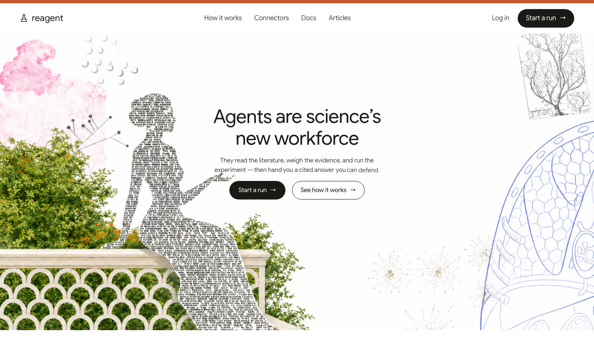
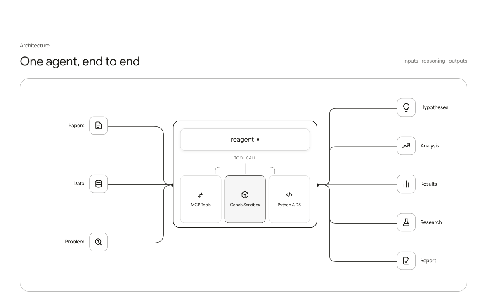
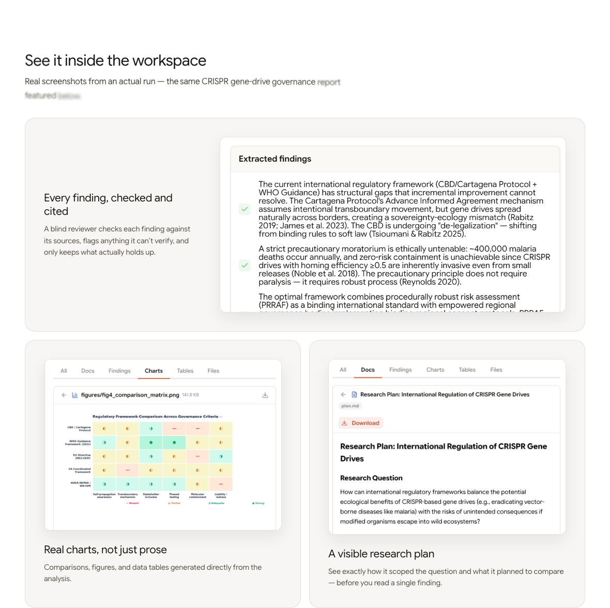
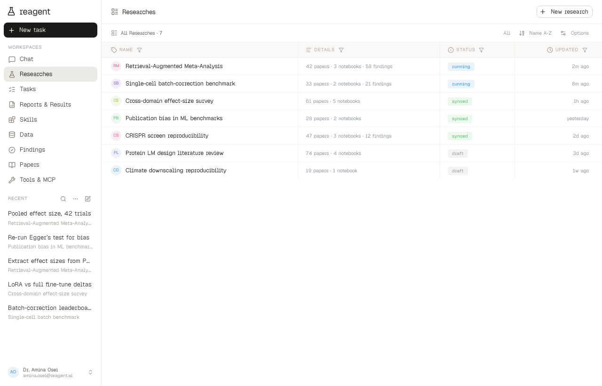

<div align="center">
  

  <h1>reagent</h1>

  <p><strong>Autonomous research agents that read the literature, weigh the evidence, and run the experiment — then hand you a cited, reproducible answer.</strong></p>

  <p>
    <a href="LICENSE"></a>
    <a href="package.json">= 20"></a>
    <a href="tsconfig.json"></a>
    <a href="https://github.com/aayush-wiz/reagent/issues"></a>
  </p>

  <p>
    <a href="#why-reagent">Why</a> ·
    <a href="#architecture">Architecture</a> ·
    <a href="#getting-started">Getting started</a> ·
    <a href="#tech-stack">Tech stack</a> ·
    <a href="#roadmap">Roadmap</a> ·
    <a href="#contributing">Contributing</a>
  </p>
</div>

<br>

## Why reagent

Retrieval tools are fast at search but stop at search — they hand back sources, not answers. Raw LLMs reason well but can't run anything. reagent is built to hold the whole research loop at once:

- **It tests competing answers, not just one.** Rival hypotheses are generated and ranked in a tournament — the weak ones get ruled out by evidence, not assumed away.
- **It runs real code, not a guess.** Analysis executes as actual Python — statistics, simulations, data pipelines — inside an isolated sandbox, and the exact code that ran ships with the report.
- **It checks its own work.** A blind reviewer flags unverifiable numbers and citation mismatches before a finding ever reaches you.
- **You stay in the loop.** Review the plan before it runs, steer it mid-course, and cancel anytime — it runs in the background so you don't have to watch it.

## What it does

Give reagent a question, and it runs the research loop end to end:

1. **Scopes** the question and searches the literature and prior findings
2. **Generates rival hypotheses** and ranks them instead of assuming the first plausible answer
3. **Runs real analysis** inside an isolated sandbox to discriminate between hypotheses
4. **Reviews its own work** — a blind pass over the output before you see it
5. **Reports back** with every finding traced to its source, the plan that produced it, and the exact code that ran

It's a loop, not a single shot: each round runs an experiment designed to rule something out, and it keeps going until the evidence decides — not a step count.

## Architecture

One agent, end to end — papers, data, and your problem statement go in; the agent reasons over them, calls out to MCP tools and a sandboxed Python environment to do the actual work, and returns hypotheses, analysis, and a cited report.



| | |
|---|---|
| **Isolated execution** | One Docker container per research (`python:3.12-slim` + numpy/pandas/scikit-learn/statsmodels + a LaTeX toolchain for PDF reports), hard resource limits, LRU-based idle reaper. |
| **Extensible by protocol** | Any MCP server becomes an instrument the agent can drive — internal APIs, compute clusters, or your own scripts, with no glue code. |
| **Specialist subagents** | A lead agent runs literature-review, critique, and write-up subagents concurrently and combines their work into one cited answer. |
| **Background-first** | Start a research, close the tab, come back to the finished report. Cancel anytime. |

## See it inside the workspace

Real screenshots from an actual run — a biosecurity policy brief on international CRISPR gene-drive governance, researched and written end to end from a single question.





## Tech stack

| Layer | Stack |
|---|---|
| Frontend | React + Vite + TypeScript, React Router, Mantine |
| Backend | [Hono](https://hono.dev) (Node), bearer-token auth (scrypt) |
| Agent runtime | Custom agent loop (Vercel AI SDK), model-agnostic — Databricks (Claude) or any OpenRouter model |
| Background jobs | BullMQ over Redis — the run queue, live pub/sub updates, and sandbox LRU state |
| Sandbox execution | One Docker container per research (`python:3.12-slim` + scientific stack + LaTeX), driven via the Docker CLI |
| Database | SQLite (`better-sqlite3`, WAL mode) via Drizzle ORM |
| Docs site | A separate Blume-powered docs app (`reagent-docs/`) |
| Auth | Email/password + "Continue with Google" via [Composio](https://composio.dev) managed OAuth |

## Getting started

**Prerequisites:** Node ≥ 20, Docker (for the sandbox), Redis (`brew services start redis` or equivalent).

```bash
git clone https://github.com/aayush-wiz/reagent.git
cd reagent
npm install
cp .env.example .env   # fill in your model provider keys
```

Start everything (web, API, worker, docs) with the project's own dev controller. It only touches this app's own fixed ports (from `ports.env`), so it won't interfere with anything else you have running:

```bash
./scripts/dev.sh start     # start
./scripts/dev.sh status    # check what's running
./scripts/dev.sh stop      # stop
./scripts/dev.sh restart   # restart
```

The app is then available at `http://localhost:5173`.

### Environment variables

See [`.env.example`](.env.example). You need at least one model provider:

| Variable | Required | Purpose |
|---|---|---|
| `DATABRICKS_TOKEN`, `DATABRICKS_HOST`, `DATABRICKS_MODEL` | one of the two providers | OpenAI-compatible model serving; powers the default model |
| `OPENROUTER_API_KEY`, `OPENROUTER_BASE_URL` | one of the two providers | Powers the other models in the model dropdown |
| `REAGENT_ENABLE_EXEC` | recommended | Enables the sandboxed compute workspace (bash / run_python) |
| `REAGENT_SUBAGENT_MODEL` | optional | Runs subagents on a cheaper/faster model, off the primary provider's rate limit |
| `EXA_API_KEY` | optional | Powers the web-search skill |

## Project structure

```
src/                  React frontend (Vite)
backend/
  ├─ agent/           the agent loop + skills (search, exec, science tools)
  ├─ sandbox/         Docker sandbox lifecycle (create, exec, reap)
  ├─ queue/           BullMQ run queue
  ├─ routes/          Hono API routes
  ├─ repositories/    SQLite/Drizzle data access
  └─ worker.ts        the background worker process
reagent-docs/         standalone documentation site
skills/               skill packs the agent can load (biology, ML, chemistry, ...)
scripts/dev.sh        start/stop/status/restart for the whole stack
```

## Roadmap

- [ ] Pluggable compute backends beyond a single local Docker host (SSH / Kubernetes / managed GPUs)
- [ ] Git-backed provenance for research workspaces (diff and revert an attempt)
- [ ] Run reattachment after a worker restart, instead of hard-failing in-flight runs
- [ ] Postgres as an alternative to SQLite for multi-instance deployments

Have an idea? [Open an issue](https://github.com/aayush-wiz/reagent/issues) — the roadmap above isn't fixed.

## Contributing

Contributions are welcome. Please read [CONTRIBUTING.md](CONTRIBUTING.md) before opening a PR, and note that this project follows a [Code of Conduct](CODE_OF_CONDUCT.md).

Never commit secrets — copy `.env.example` to `.env` and keep your own keys local; `.env` is gitignored by default.

## License

Distributed under the MIT License. See [LICENSE](LICENSE) for details.
